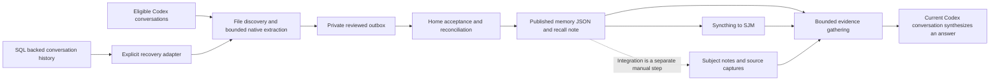

# K2B Conversation Knowledge Audit

Prepared for Keith on 24 October 2026. Operational measurements were taken at 22:28 HKT; scope, retrieval and source checks continued through 22:45 HKT. This is an audit and proposed design, with no implementation or runtime activation authorized by the audit request.

K2B has a functioning, evidence-bound capture and transport foundation. Its weakest stages are selecting the right evidence for a question and integrating captured assertions into current subject notes. Keep the existing vault, provenance receipts, note writer and two-Mac topology. Improve the missing connections between these stages before considering a replacement knowledge system.

The accompanying implementation plan is `plans/2026-10-24_k2b-conversation-knowledge-improvement-plan.md`.

## Observed process

Automatic extraction records facts, decisions, preferences and commitments. Publication updates a generated memory snapshot and recall note. It does not automatically enrich all the related person, project, work and concept pages. The compile and weave lanes remain separate, supervised workflows.

## What works

| Stage | Home | SJM |
| --- | --- | --- |
| Native job registration | Active, every six hours | Active, every six hours |
| Latest canonical completion | 24 October, 20:10:40 HKT | 24 October, 20:30:08 HKT |
| Extraction hold | Absent | Absent |
| Local delivery acknowledgements | 414 accepted, zero pending or failed | 331 accepted, zero pending or failed |
| File-backed coverage in the approved window | 92 of 103 completed turns extracted; 11 pending | 74 of 74 extracted; zero pending |
| Additional SQL-only pending turns | Zero | One, completed 21 September at 14:43:54 HKT |
| Source scan validity | Complete; zero invalid receipts, source errors or parse exceptions | Complete; zero invalid receipts, source errors or parse exceptions |
| Syncthing | Idle, zero needed files/bytes/directories, zero errors | Idle, zero needed files/bytes/directories, zero errors |
| Counterpart | Connected, 100 percent completion | Connected, 100 percent completion |
| Live authority check | Passed | Passed |

The Home pending turns began at 21:00:05 HKT, after the latest native run. Their presence is consistent with the six-hour cadence and is not, by itself, a capture failure. The older SJM pending turn matches the existing repair record's unavailable clipboard-image case. The audit did not stage, extract, dismiss or retry it.

Native app scheduler records and native thread metadata confirm actual automation-origin dispatches on both Macs. These are stronger evidence than registration alone. They establish observed runs, rather than seven days of reliable operation of the final repaired version.

All 745 accepted Home deliveries validated against their reconciliation receipts, effective key resolutions and private memory versions. Their exact watermark matched the latest publication receipt. Private and published records matched, and the publication's artifact hashes matched the live files. The published JSON and recall note also matched independently on SJM. A normal exact-key recall of a decision captured in the latest Home run returned the same current value and source event on both Macs.

The snapshot contained 1,151 records: 793 facts, 187 decisions, 153 preferences and 18 commitments. This is a record count, not a conversation count or an integration-completeness measure. The JSON was about 1.57 MB and the generated recall note about 847 KB.

## Findings

### F1 Evidence selection loses the relevant subject

Priority: P1. Reproduced on both Macs with the installed normal CLI.

Ten broad queries were checked against existing canonical subject notes. Two included their expected note: the Airtable connection query and the Chinese Kingdee query. Eight omitted it. An additional explicitly selected Galaxy topic control succeeded, and an unknown-term control returned no evidence.

| Query | Expected evidence | Observed first retained note on both Macs |
| --- | --- | --- |
| Galaxy FM mapping | Galaxy FM mapping work note | Digital marketing hiring note |
| Rachel Pulse+ | Rachel's person note, with HRIS context | Call-centre consolidation note; no Pulse evidence retained |
| Kingdee HRIS recovery | Kingdee HRIS recovery work note | ASUS router recovery feature note |
| Pulse+ original go-live target | Corrected Kingdee timeline | Google AI VPS feature note; no Pulse evidence retained |
| running dashboard cloud fetch | Running dashboard project note | Retired Telegram URL-prefetch feature note |

These results measure inclusion of expected evidence in the first bounded packet. They are not an answer-accuracy score: a model can perform follow-up searches, and a relevant memory record can sometimes answer a question without the canonical note. Nevertheless, several packets did not retain evidence about the requested subject at all.

The implementation explains the behavior:

- `_candidate_note_files` adds index-discovered notes to `seen` before ranking filename matches. A specifically named note already found through an index cannot then gain its stronger filename ranking. Index row order can dominate relevance.
- Broad matching accepts any query substring. Generic words such as recovery, application or running can introduce unrelated candidates.
- `_render_memory_evidence` visits keys alphabetically and matches evidence quotations as well as key/value text. Incidental mentions can consume the packet ahead of direct subject matches.
- The 48,000-byte packet bound often leaves one note and a memory source. Those safety limits expose the ranking problem; increasing the limits alone would not repair it.

A controlled temporary-vault check also showed that selected-topic expansion follows bare wikilinks, aliases and heading links, but ignores vault-path wikilinks and Markdown links. The main index resolver already supports more formats than this topic-expansion path.

Owning source: `scripts/lib/k2b_context.py`, especially `_candidate_note_files`, `_render_memory_evidence`, `_linked_notes` and packet trimming. Existing tests preserve a leading note under memory pressure, but do not adequately test whether that leading note is the right one in this vault.

### F2 Publication does not establish subject integration

Priority: P1. Confirmed workflow gap, with examples of both good and incomplete integration.

The native publisher owns the memory JSON, generated recall note and their index/log records. It has no subject-note enrichment step. The active compile and weave contracts require separate supervised work. There is no complete source-item-to-subject-note accounting from which to report how many of the 1,151 records have been integrated.

The generated recall note contains one wikilink, to an index. Its many dated facts remain available to text search, but they do not become individual Obsidian relationships.

Good integration already exists. Rachel's note connects her to HRIS recovery, restructuring, AI implementation and hiring. The Kingdee note clearly separates the latest confirmed timeline from earlier positions and identifies Keith, Rachel and Danny's respective roles.

An incomplete example is Amy Lin: the subject note's current summary is explicitly dated 18 September, while published memory includes a 21 October statement about HR coordination during her familiarization period. That later statement has not been incorporated into the subject summary. Its existence does not establish that an email was sent or that onboarding occurred.

A twelve-record inspection across the four memory kinds found useful source quotes and preserved speaker attribution, including an explicitly labelled assistant report. This was a small quote-level review, not independent verification of every claim or proof of extraction completeness. Hash-valid evidence can still need semantic interpretation and subject integration.

Owning sources: `scripts/lib/automatic_memory_publisher.py`, `scripts/prompts/automatic-memory-native.md`, `.agents/skills/k2b-compile/SKILL.md`, `.agents/skills/k2b-weave/SKILL.md`, `scripts/vault-note-write.py`.

### F3 Capture coverage is narrower than the user's likely mental model

Priority: P2. A contract and visibility issue, with an intentional current boundary.

Both the file and SQL adapters restrict automatic scope to eligible user-origin Codex conversations whose project path matches K2B or K2Bi. The inclusive automatic window begins on 13 September 2026. Kimi Work, phone conversations, other project folders and earlier history do not acquire automatic coverage merely because they relate to Keith's work.

A bounded native SQL metadata inventory found 505 in-scope completed turns on Home and 492 on SJM in that window. It also found seven completed Home turns in other Codex workspaces and four SJM turns in Service Motion outside the automatic scope. These are scope exclusions, not eleven asserted missing facts; some knowledge may have been saved manually. The metadata inventory is not an inventory of all content in every possible source format.

The file and SQL coverage counts overlap and must not be added. SQL metadata includes file-backed conversations. The SQL recovery adapter can identify missing file-backed history, but the registered worker prompt selects the file-backed worklist and does not automatically run the SQL recovery selector. Future SQL-only arrivals can therefore require operator recovery even when the ordinary file backlog is zero.

Keep the current boundary until Keith explicitly approves another one. Make exclusions visible before promising whole-conversation coverage. Service Motion footage and unrelated production systems remain outside K2B.

Owning sources: `PROJECT_SCOPE_RE`, `build_memory_worklist` and `memory_backlog` in `scripts/lib/eod_capture.py`; `_eligible` and `scan` in `scripts/lib/codex_sql_memory.py`; the native worker prompt and registered job definitions.

### F4 Current assertions and current project state can diverge

Priority: P2. A temporal and entity-resolution risk.

The snapshot uses schema 1 and has no accepted cross-key correction relations. Most records have a single version. A key's current disposition means the latest retained assertion for that key, not a fresh verification of the entire project's present state.

For example, the Pulse+ records preserve an earlier recollection of the original target and a later confirmed timeline under different keys. The Kingdee subject note already explains the correction. Readers need that note or an explicitly reviewed relationship to avoid treating differently keyed historical statements as interchangeable current answers.

Do not automatically merge similar keys or apply a universal latest-date-wins rule. Preserve what was said, who said it, what question it answered and whether a newer statement changes it. Existing correction machinery is reusable after its activation requirements are met.

### F5 Queue labels and old operating guidance create misleading signals

Priority: P2.

The raw-note helper lists 135 items older than 24 hours as needing compilation. Twenty-eight are technical orchestrator inbox/results material. The other 107 include 61 session captures, 37 research notes and smaller human-capture groups. Missing flags are not proof that their contents were never integrated. The raw set contains 202 notes: 20 marked true, 46 skipped, two deferred, one pending, nine false and 124 with a missing or unreadable compilation value.

The compile contract proposes editing compilation flags in raw sources, while live AGENTS.md requires raw captures to remain immutable after creation. Compilation completion needs an external receipt, rather than another exception inferred at run time. The legacy worker also receives indexes rather than current note bodies and still contains an instruction to substitute double hyphens in prose, contrary to the live writing rule.

The current projects index still describes K2B using Claude and labels the retired always-on Mini project active. The required lifecycle reference also contains old Inbox and Claude instructions. They are dated content, not authority, but prominent discovery surfaces should label retirement and current ownership clearly. No inspection or contact with the retired host is required to fix those descriptions.

The ordinary status and SessionStart readers correctly avoid equating registration with complete ingestion. They still do not provide one current account of file coverage, SQL coverage, publication, integration and recall quality.

### F6 Replication works, while shared freshness needs a measured contract

Priority: P2. Schedule inference, not a measured service-level guarantee.

Home's observed dispatch was around 20:07 and SJM's around 20:29. Home therefore drained before SJM's corresponding extraction opportunity. At this alignment, a new SJM delivery can wait close to another six-hour cycle for Home reconciliation. A conversation completed just after an SJM cycle can approach twelve hours before shared publication, even with online hosts and no exceptional failure. Budget deferrals and downtime can extend that further.

The native prompt's limits remain appropriate safeguards: at most 12 turns, 240,000 cumulative input-view bytes and 20 minutes per run, with a 48,000-byte current-turn view limit. Four six-hour cycles imply a theoretical ceiling of 48 turns per day before byte/time limits. SJM had 40 in-scope completed turns on 22 October. Capacity should be measured against real arrival sizes before changing cadence or bounds.

### F7 Two-host verification has one portability failure

Priority: P2.

The seven focused capture, SQL, memory, publisher and context test modules passed all 689 tests on Home under Python 3.12.2. On SJM, the same command produced 689 passes and one failure; SJM has one additional uncommitted parser regression test.

The failing test expects a complete temporary receipt path in stderr. The redactor treats part of SJM's long temporary path as token-like text and removes it. The same single test passed with an isolated short temporary base. Preserve redaction and correct the portability assumption; this failure is not evidence that reconciliation or stored data failed.

Home HEAD was `e04a84a`; SJM HEAD was `b6c5360`. The portable files checked mostly matched, with the intended local AGENTS.md adaptation and an uncommitted SJM `eod_capture.py` parser change as exceptions. Both checkouts contain other unfinished work. Any future update must preserve and deliberately review those changes.

## Required behavior after improvement

1. State exactly which conversations are covered, which are pending, which are blocked and when that observation was made. Retain source-specific failures and unknown coverage.
2. Preserve existing source evidence, receipts, manual notes and recoverability. An unavailable attachment never becomes a successful empty extraction.
3. Bring the relevant current subject evidence into a bounded answer packet before incidental historical matches. State gaps and preserve citations and authorship.
4. Account for each reviewed integration item as integrated, intentionally retained as a leaf, needing review or blocked. Show the source and target note receipts.
5. Update current summaries and meaningful relationships while retaining dated history. Graph density is not an acceptance target.
6. Make real cross-Mac freshness and capacity measurable without increasing provider spend or silently enabling a new worker.

## Recommended delivery order

| Order | Deliverable | Done check |
| --- | --- | --- |
| 1 | Recall regression set, ranking and evidence-budget repair | All ten canonical-evidence cases, anchored and unknown controls pass on both Macs within existing bounds |
| 2 | Unified coverage and freshness report | Reconciles overlapping file/SQL inventories and shows scope, exclusions, actual dispatch, pending age, publication and unknown states |
| 3 | Supervised subject integration with receipts | Three selected topics updated from reviewed evidence; replay changes no note or receipt twice; raw sources unchanged |
| 4 | Current guidance and queue classification repair | Live discovery surfaces agree with current authority; compile completion uses receipts; portable test baseline clean |
| 5 | Two-host acceptance and an explicit automation decision | Genuine source-to-recall paths verified; schedule and capacity observations meet the proposed contract; any background integration has separate approval |

## Acceptance and limits

The existing ten broad cases are a fixed regression set, not a general recall-quality estimate. Add twenty held-out, source-grounded questions across people, projects, Chinese/English queries, corrected decisions, negative cases and pending cross-Mac work. Target at least 18 of 20 correct and sufficiently sourced answers, with all critical authorship, correction and unsupported-claim checks passing. Keep the existing 48,000-byte, 20-source and 80-span bounds and report partial results honestly.

For integration, first use Amy onboarding, Kingdee/Pulse+ and K2B's current operating model as supervised cases, re-reading all sources and current note hashes immediately before any save. Do not convert drafts, intended actions or assistant completion reports into completed business events. Integration must retain dated provenance and explain the link's meaning.

For unattended acceptance, observe the final deployed version for seven consecutive days, including at least one genuine nonempty scheduled extraction from each host and subsequent Home publication and recall on both Macs. An empty run, manual catch-up or configured schedule alone is insufficient. A proposed schedule alignment should target shared availability within seven hours for ordinary in-scope conversations when both Macs are online and the approved run capacity is sufficient. Validate that target before treating it as a promise.

Automatic capture outside the current project/date scope, automatic SQL source selection, schedule changes and background subject-note integration each require explicit authorization before activation. No paid API dependency, embedding service, local model, new external channel or retired host is needed for the first improvements.

## Evidence and audit boundaries

Private reproducible evidence is under `/Users/keithmbpm2/.local/state/k2b/audits/process-20261024-94mfb6av/`: `home.json`, `sjm.json`, both scope and dispatch inventories, both recall benchmarks, exact-key recall outputs, `provenance.json`, `vault.json`, the twelve-record semantic sample and test logs. These files are machine-local; the shared audit preserves their relevant findings without moving native history or credentials.

The link scan found 353 wiki Markdown files. Excluding indexes and the activity log left 340 pages, 313 in the largest component and 24 without peer links. Excluding the recovery catalogue as another navigation hub left 85 of 339 pages without peer links; some are intentionally retained source leaves. This refined parser excludes absolute external file links, correcting the earlier conversational estimate of 316 connected pages. None of these counts establishes semantic quality.

Existing source notes informing the audit: `wiki/reference/2026-10-24_k2b-automatic-memory-repair.md`, `wiki/work/work_kingdee-hris-recovery.md`, `wiki/work/work_treasury-ir-svp-search.md`, `wiki/people/person_Rachel-Chan.md`, `wiki/projects/project_running-dashboard.md`, `wiki/context/context_k2b-note-lifecycle.md` and the published automatic-memory snapshot.

This audit used bounded source and native-history metadata checks. It did not verify every conversation ever held, inspect retired-host state, run new extraction, change schedules or holds, invoke a paid provider, or modify production applications. Fresh desktop hook execution was not independently demonstrated; direct hook/authority checks cannot establish that UI acceptance. No independent Kimi review of an implementation is claimed because this delivery contains an audit and plan only.
